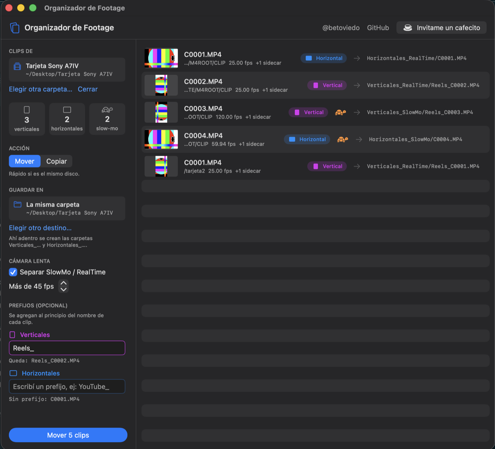
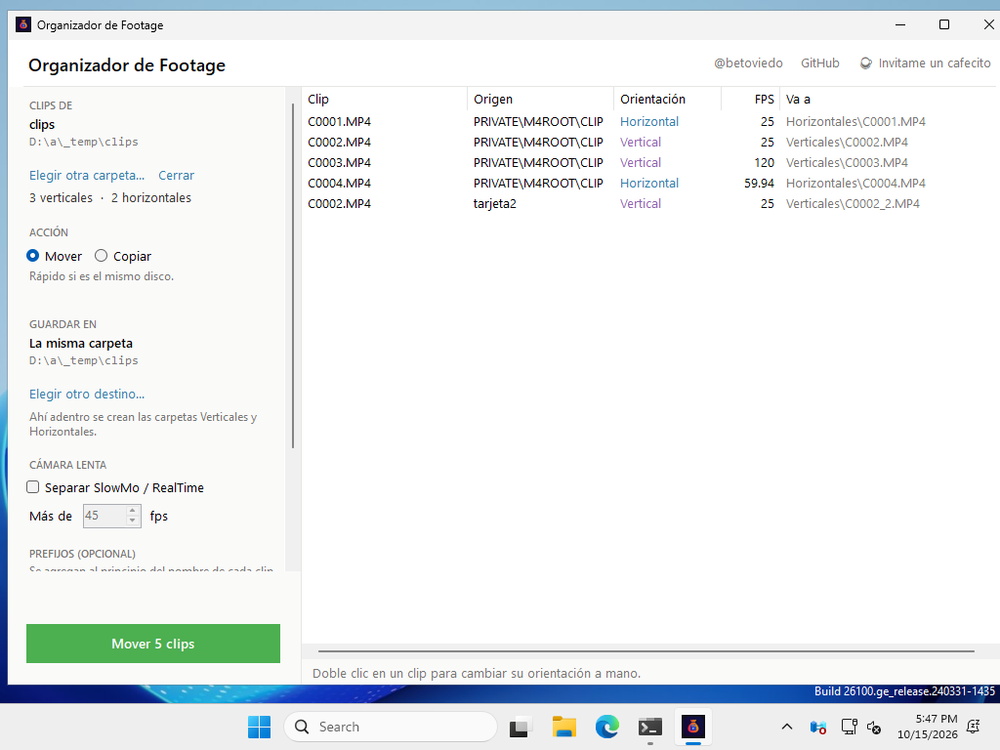

# 🎬 Organizador de Footage

App gratuita para **Mac** y **Windows** (beta) que separa los clips de tu cámara en **verticales** y **horizontales** (y cámara lenta) en segundos.

**[Descargar y ver instrucciones →](https://betoviedo.com/Tools/Organizador_Footage/)**

```
Antes                Después
C0001.MP4      →     Horizontales/C0001.MP4
C0002.MP4      →     Verticales/Reels_C0002.MP4
C0003.MP4      →     Verticales/Reels_C0003.MP4
```

| Mac | Windows (beta) |
|:---:|:---:|
|  |  |

## Qué hace

- **Vista previa:** ves cómo queda cada clip antes de mover nada, con miniatura y fps.
- **Mover o copiar:** copiar deja los originales como backup.
- **Guardar donde quieras:** en la misma carpeta o en otra (ej: un disco externo).
- **Slow motion:** separa los clips de más de 45 fps (ajustable).
- **Prefijos:** ej. `Reels_` para verticales, `YouTube_` para horizontales.
- **Sidecars incluidos:** los XML / THM / XMP viajan con su clip.
- **No pisa archivos:** si dos tarjetas tienen `C0001.MP4`, ninguno se pierde.
- **Busca en subcarpetas:** podés arrastrar la tarjeta entera (`PRIVATE/M4ROOT/CLIP/...`).

Funciona con Sony, Canon, Nikon, DJI y cualquier cámara que grabe MP4 / MOV.

## Instalar en Mac

Requiere macOS 13 o superior (Apple Silicon o Intel).

**Opción 1 — Terminal (sin avisos de macOS):**

```bash
curl -fsSL https://betoviedo.com/Tools/Organizador_Footage/OrganizadorFootage-App.zip -o /tmp/of.zip && rm -rf /tmp/of && ditto -x -k /tmp/of.zip /tmp/of && ditto "/tmp/of/Organizador de Footage.app" "/Applications/Organizador de Footage.app" && open "/Applications/Organizador de Footage.app"
```

**Opción 2 — ZIP:** descargalo desde la [página](https://betoviedo.com/Tools/Organizador_Footage/), arrastrá la app a Aplicaciones y la primera vez andá a **Ajustes del Sistema → Privacidad y seguridad → Abrir igualmente**. El aviso aparece porque la app no está firmada con una cuenta paga de Apple Developer.

**Opción 3 — Acción Rápida del Finder:** para usarlo con clic derecho sobre una carpeta → **Acciones rápidas → Organizar Footage**, sin abrir la app. Requiere [ExifTool](https://exiftool.org) ("MacOS Package"). Descargá [`OrganizarFootage-AccionRapida.zip`](https://github.com/betropical/organizador-de-footage/releases/latest/download/OrganizarFootage-AccionRapida.zip), abrilo y hacé doble clic en `Organizar Footage.workflow` → **Instalar**. No tiene vista previa ni Deshacer, y guarda en la misma carpeta.

## Instalar en Windows (beta)

Requiere Windows 10 u 11. No necesita instalar nada.

1. Descargá [`OrganizadorFootage-Windows.zip`](https://github.com/betropical/organizador-de-footage/releases/latest/download/OrganizadorFootage-Windows.zip) y descomprimilo (clic derecho → Extraer todo).
2. Doble clic en `OrganizadorFootage.exe`.
3. Si aparece **"Windows protegió tu PC"**: **Más información → Ejecutar de todas formas**. Aparece porque la app no está firmada con un certificado pago.

**Clic derecho (opcional):** guardá el `.exe` en una carpeta fija, abrilo y tocá **"+ Agregar al clic derecho"**. Después: clic derecho sobre una carpeta → **Enviar a → Organizador de Footage** (en Windows 11, dentro de "Mostrar más opciones"). También se puede hacer con `OrganizadorFootage.exe /agregar-enviar-a` (y `/quitar-enviar-a`).

Es una beta: probala primero con **Copiar**. Si algo falla, contalo en [Issues](https://github.com/betropical/organizador-de-footage/issues).

## Panel para Premiere Pro

Un panel dentro de Premiere (CC 2018 en adelante, Mac y Windows) con dos modos:

- **Proyecto:** ordena en bins `Verticales` / `Horizontales` (y SlowMo) los clips que ya importaste. No toca los archivos.
- **Carpeta:** importa una carpeta o tarjeta con todo mezclado y la deja dividida en bins. Saltea lo que ya está en el proyecto. También puede mover o copiar los archivos en el disco, como la app.

Opcionalmente crea una secuencia por grupo. Todo se puede deshacer.

**Instalar:** abrí la app (Mac o Windows) y tocá **"+ Instalar panel para Premiere Pro"**. Reiniciá Premiere y abrilo desde **Ventana → Extensiones → Organizador de Footage**. También se puede instalar el `.zxp` con [ZXP Installer](https://aescripts.com/learn/zxp-installer/).

El código está en [`premiere/`](premiere/). Lee la orientación del archivo con su propio lector ([`premiere/js/mp4info.js`](premiere/js/mp4info.js)) y, si no puede, usa lo que informa Premiere.

## ¿Es segura?

Todo el código está acá: [`App/OrganizadorFootage.swift`](App/OrganizadorFootage.swift) (Mac) y [`windows/`](windows/) (Windows). La app:

- Solo lee y mueve/copia archivos en las carpetas que elegís.
- No se conecta a internet ni junta datos.
- En Mac lee la orientación y los fps con AVFoundation; solo para formatos que macOS no abre (Canon CRM, Nikon NEV) usa [ExifTool](https://exiftool.org) si lo tenés instalado.
- En Windows usa su propio lector de MP4 / MOV ([`windows/Mp4Info.cs`](windows/Mp4Info.cs)), sin dependencias.
- Análisis en VirusTotal: [Mac 0/64](https://www.virustotal.com/gui/file/da99a89b59838a4ac65cc9c30d35f48d021aad4359b4cec6657b085162d2f786) · [Windows 3/67](https://www.virustotal.com/gui/file/a73afb8152b3f30fef593d86cbbacf25560bb8ab00691ec45eaa77a59b588a0d) (3 alertas genéricas de "machine learning" en antivirus menores, por ser una app nueva y sin firma).

## Compilar

### Mac

Necesitás las Command Line Tools de Xcode (`xcode-select --install`).

```bash
./build.sh
```

Genera en `dist/`:

- `Organizador de Footage.app` — la app (universal: Apple Silicon + Intel)
- `Organizar Footage.workflow` — Acción Rápida para el Finder (usa `organizar.sh` + ExifTool)
- Los ZIPs listos para distribuir

### Windows

```bash
dotnet build windows/OrganizadorFootage.csproj -c Release
```

Se puede compilar desde Mac, Linux o Windows. GitHub Actions ([`.github/workflows/windows.yml`](.github/workflows/windows.yml)) la compila en Windows, la abre con clips de prueba y adjunta el ZIP a cada versión publicada.

### Panel de Premiere

```bash
./build-premiere.sh            # firma el panel → dist/OrganizadorFootage-Premiere.zxp / .zip
premiere/instalar-dev.sh       # o instalar-dev.bat: instala sin firmar, para desarrollo
```

`build-premiere.sh` crea un certificado propio la primera vez y copia el panel firmado a `windows/PanelPremiere.zip`, que la app de Windows lleva adentro. `build.sh` lo mete en la app de Mac.

### Script de línea de comandos

`organizar.sh` hace lo mismo desde la Terminal (requiere ExifTool):

```bash
./organizar.sh --simular --slowmo --pv Reels_ /ruta/a/la/carpeta
./organizar.sh --help
```

## Autor

Hecho por [@betoviedo](https://www.instagram.com/betoviedo/). Si te ahorró tiempo, podés [invitarme un cafecito ☕](https://cafecito.app/beto_oviedo).

Licencia [MIT](LICENSE).
